<p align="center">
  <a href="https://echoness.itch.io/the-order-of-elf-remake">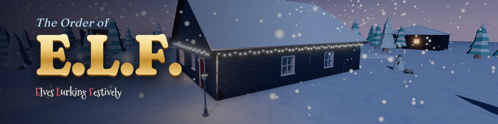</a>
</p>

<h1 align="center">The Order of E.L.F.</h1>
<p align="center"><b>Elves Lurking Festively</b> · a cosy Christmas stealth immersive sim for the browser</p>

<p align="center">
  <a href="https://echoness.itch.io/the-order-of-elf-remake"></a>
  <a href="media-kit/"></a>
  <a href="https://solarlunareclipse.itch.io/order-of-elf"></a>
</p>

<p align="center">
  <a href="https://github.com/e-choness/the-order-of-elf/stargazers"></a>
  <a href="https://github.com/e-choness/the-order-of-elf/commits"></a>
  <a href="https://github.com/e-choness/the-order-of-elf/graphs/commit-activity"></a>
  <a href="https://github.com/e-choness/the-order-of-elf/actions/workflows/ci.yml"></a>
  <a href="https://github.com/e-choness/the-order-of-elf/actions/workflows/deploy-itch.yml"></a>
  <a href="https://github.com/e-choness/the-order-of-elf/releases"></a>
  
  
  <a href="LICENSE"></a>
</p>

<p align="center">
  
  
  
  
  
  
  
</p>

<!-- countdown:start -->
<p align="center"></p>
<!-- countdown:end -->

<p align="center">
  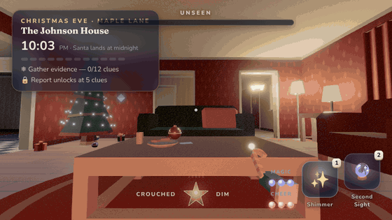
  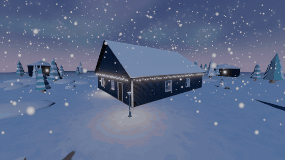
</p>

> Every Christmas Eve, wish lists get smudged. Slide down the chimney, sneak past parents, pets and one
> very suspicious robot vacuum, gather evidence of what the child **really** wants — then decide whether
> their list goes to **Santa** 🎅 or **Krampus** 👹.

## 🎮 Play

| | |
| --- | --- |
| **Web remake** (recommended) | **[echoness.itch.io/the-order-of-elf-remake](https://echoness.itch.io/the-order-of-elf-remake)** — free, runs in your browser |
| **Original jam game** (Unity) | [solarlunareclipse.itch.io/order-of-elf](https://solarlunareclipse.itch.io/order-of-elf) |
| **Run locally** | `npm install && npm run dev` → <http://localhost:5173> |

Desktop browser with keyboard & mouse. Best with headphones 🎧.

## ✨ Features

<table>
<tr>
<td width="50%" valign="top">

**🔦 Light & shadow stealth** — a live light gem samples every lamp, the fire, torch beams and
moonbeams through the windows. Switch lamps off… and watch someone switch them back on.

**👂 Sound that travels** — carpet muffles, tile clatters, floorboards squeak, glass baubles
shatter; walls and closed doors dampen it all.

**🧠 A household with routines** — wrapping presents, midnight snacks, phone calls,
gossip about the kids. Suspicion → investigation → chase → search.

</td>
<td width="50%" valign="top">

**✨ Elf magic** — Shimmer, Morph, Second Sight, Jingle Lure and Christmas Cheer dust.

**🧰 Imsim toolkit** — hide in wardrobes, under beds, behind curtains, among presents or in a
cardboard box; throw things; climb furniture; befriend the dog; eat Santa's cookies.

**🕵️ Deduction** — wishes, deeds and rumours, with decoys that only careful reading exposes.
File your report: right gift + right ledger = promotion.

</td>
</tr>
</table>

## 🖼️ Screenshots

| | | |
| --- | --- | --- |
| 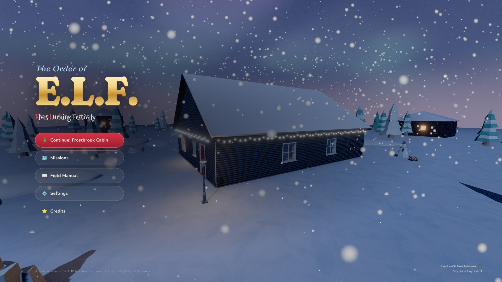 | 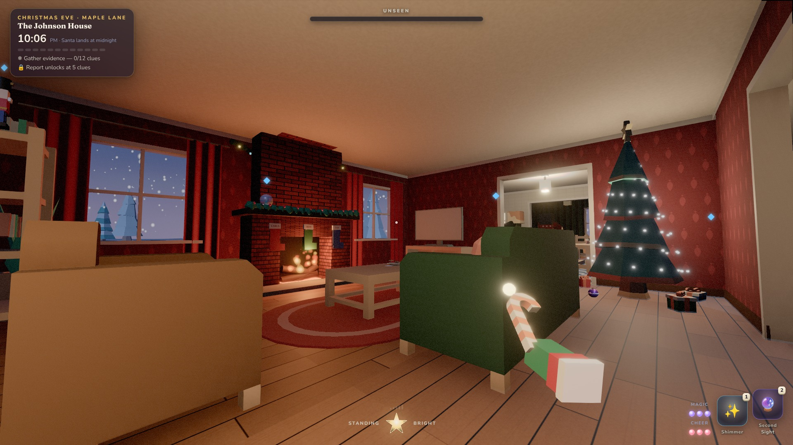 | 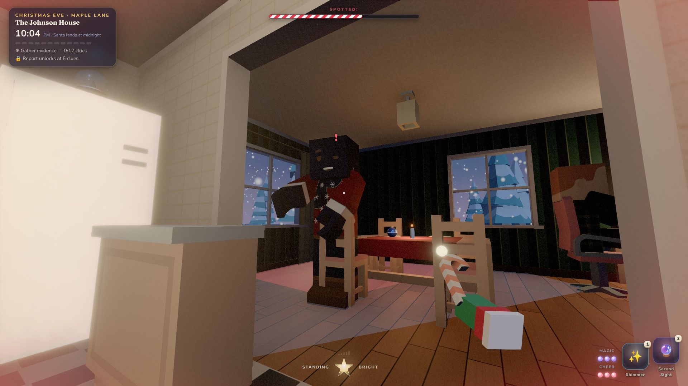 |
| 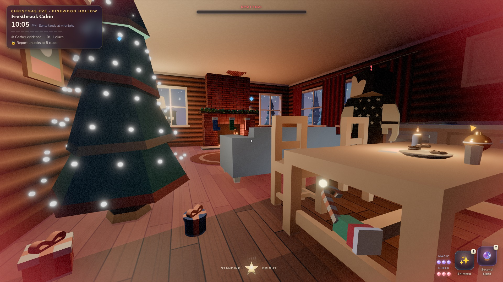 | 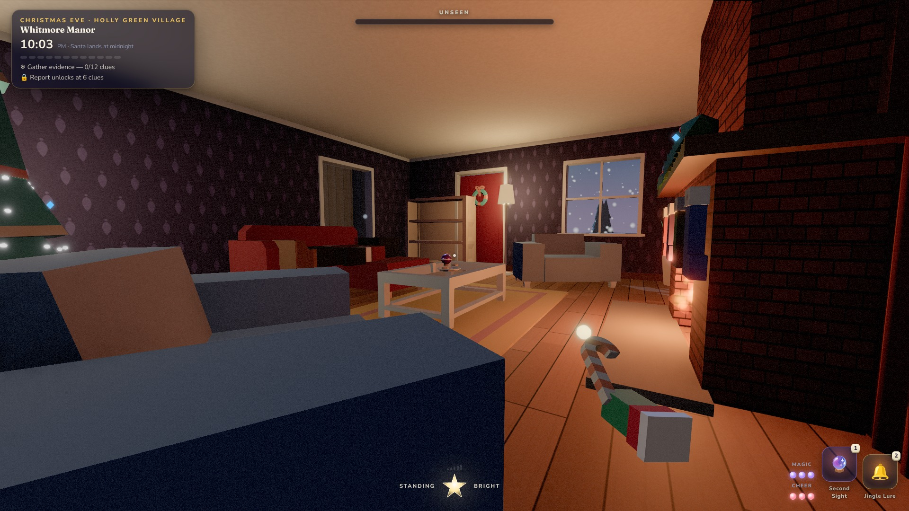 | 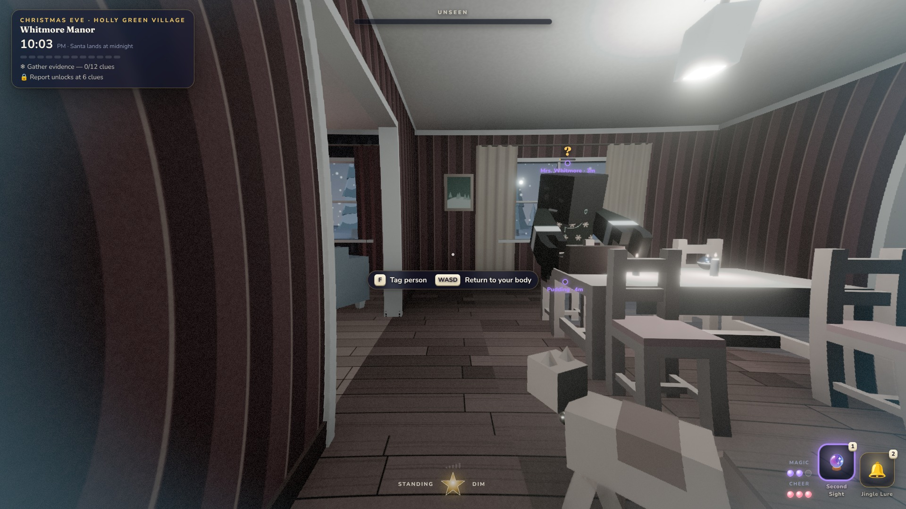 |
| 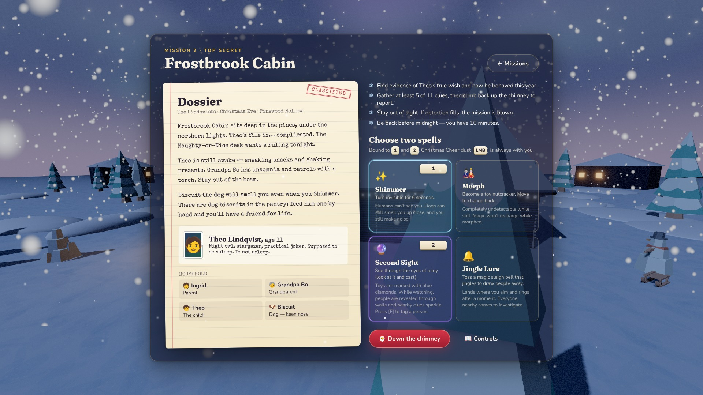 | 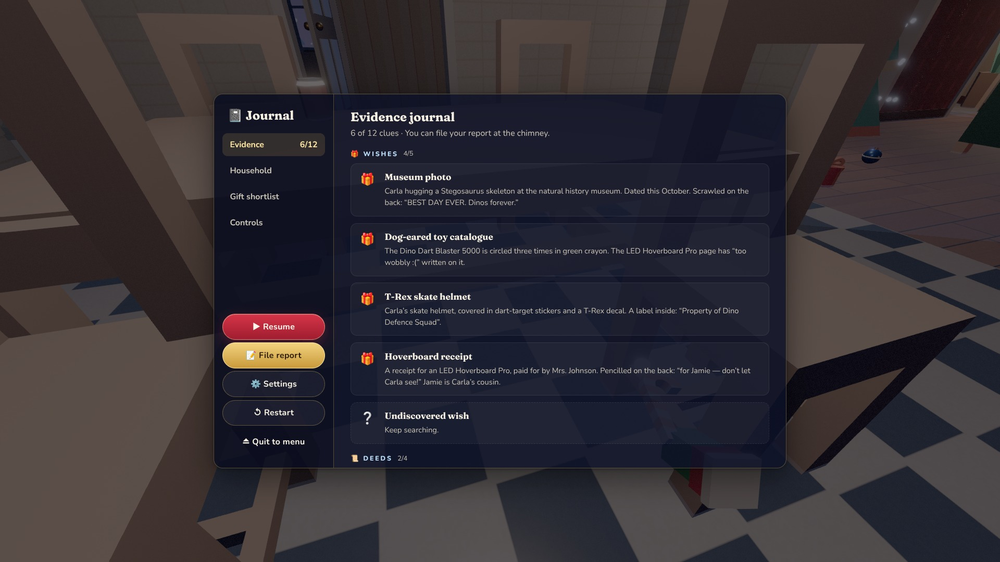 | 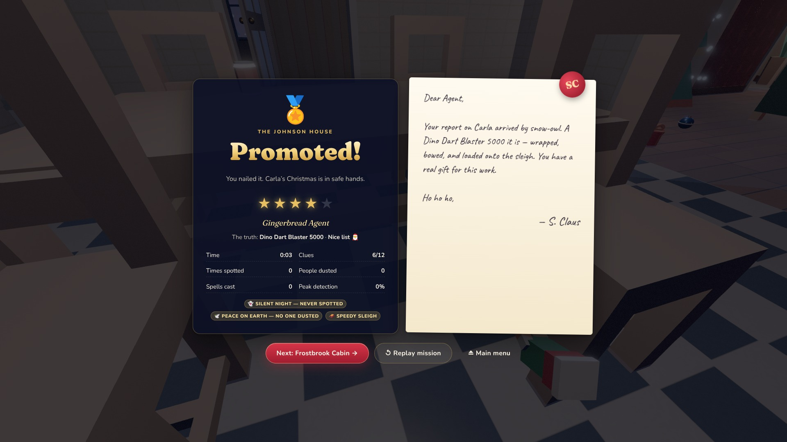 |

More in the **[media kit](media-kit/)** — logos, key art, banners, icons, GIFs and a fact sheet.

## 🗺️ Missions

| # | House | Child | Twist |
| --- | --- | --- | --- |
| 0 | **Elf Academy: Night Drill** | “Holly Practice” | Guided training against a clockwork automaton |
| 1 | **The Johnson House** | Carla, 9 | The original jam level, expanded — a cat who gossips |
| 2 | **Frostbrook Cabin** | Theo, 11 | The kid is awake, Grandpa has a torch, the dog smells magic |
| 3 | **Whitmore Manor** | Ollie, 7 | Teen on her phone, dozing aunt, motion-sensor lights, robot vacuum |

## 🚀 Releases & deployment

Every push to `main` is built and shipped to **[itch.io](https://echoness.itch.io/the-order-of-elf-remake)** by GitHub Actions
using [butler](https://itch.io/docs/butler/); tagging `v*` also publishes a
[GitHub Release](https://github.com/e-choness/the-order-of-elf/releases) with a ready-to-host zip.
Setup and details: [docs/DEVELOPMENT.md](docs/DEVELOPMENT.md#deploying).

## ⌨️ Controls

| Key | Action | Key | Action |
| --- | --- | --- | --- |
| `W A S D` | Move | `E` | Interact · hide · hold to search |
| `Mouse` | Look | `Left click` | Christmas Cheer / throw held item |
| `Shift` | Sprint (loud) | `Right click` | Drop held item |
| `Q` / `C` | Crouch | `1` `2` | Cast spells |
| `Space` | Jump / climb | `F` | Tag a person (Second Sight) |
| `Tab` / `Esc` | Journal & pause | `3` | Report (all clues found) |

<details>
<summary><b>🧠 How the household thinks</b> (NPC state machine)</summary>

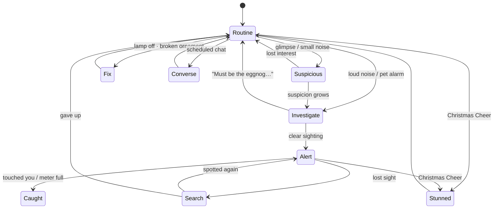

</details>

<details>
<summary><b>🔁 The mission loop</b></summary>

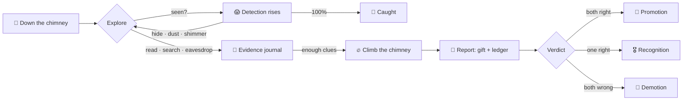

</details>

<details>
<summary><b>🛠️ Tech stack & project layout</b></summary>

| Layer | What |
| --- | --- |
| Rendering | three.js r186 · pmndrs postprocessing (N8AO, mip bloom, SMAA, AgX) · custom grading pass |
| World | procedural house builder (walls, openings, trim, roof), Kenney CC0 props, canvas textures |
| AI | grid A* with string-pulling, perception (sight/hearing/smell), routines & conversations |
| Audio | Web Audio: HRTF sound effects, live-synthesised public-domain carols that react to tension |
| UI | DOM + CSS (frosted glass HUD), Fraunces / Nunito / Caveat / Special Elite fonts |
| Tooling | Vite 8, TypeScript (strict), level validator at `/#validate`, GitHub Pages workflow |

```
src/            ← game code: core · world · game · ui · levels · dev
public/assets/  ← Kenney CC0 models, textures, audio (+ licence files)
media-kit/      ← press kit: screenshots, logos, art, GIFs, fact sheet, store copy
docs/           ← development guide
.github/        ← CI, itch.io deploy, Pages deploy, Christmas countdown
```

Developer guide: **[docs/DEVELOPMENT.md](docs/DEVELOPMENT.md)**.

</details>

---

## 🧊 The original Unity game

The Order of E.L.F. started as a stealth adventure made by **ABK Jam Team 7** in Unity 2021.3.26f1:
use magic and cunning to gather intel on a child during Christmas Eve — your findings decide whether
their list goes to Santa or Krampus.

[](https://solarlunareclipse.itch.io/order-of-elf)

<details>
<summary>Original game rules, controls and win criteria</summary>

The Unity 2021.3 project (built with [Gold Player](https://github.com/Hertzole/gold-player)) has been retired from this
repository — browse it any time at the [last Unity commit (`ed82f37`)](https://github.com/e-choness/the-order-of-elf/tree/ed82f37).

#### Core gameplay
- **Objective**: Gather all Christmas clues located throughout the house before time runs out.
- **Avoid detection**: Stay hidden from AI while hunting for clues.
- **Game over**: Time runs out or detection reaches 100%.
- **Win**: Submit your report after finding all clues.

#### Win criteria
- **ELF Promotion (true win)**: both gift and list are correct.
- **ELF Recognition (partial win)**: either gift or list is correct.
- **ELF Demotion (loss)**: both gift and list are incorrect.

#### Controls
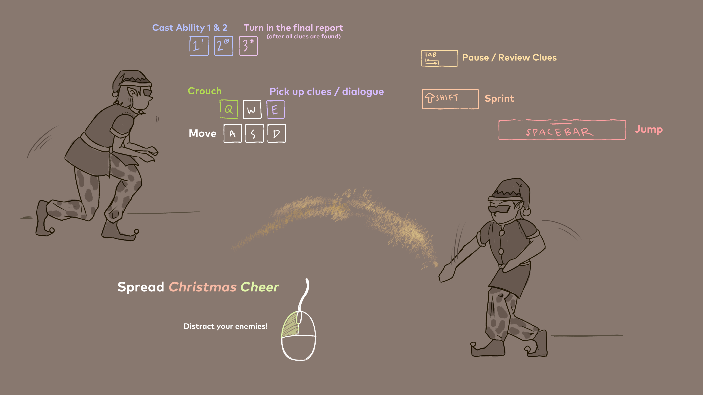

`WASD` move · `Mouse` camera · `Q` crouch · `Space` jump · `Shift` sprint · `Left click` Christmas Cheer ·
`E` dialogue / pick up clues · `1` `2` magic abilities · `Tab` pause / review clues · `3` final report

#### Magic abilities
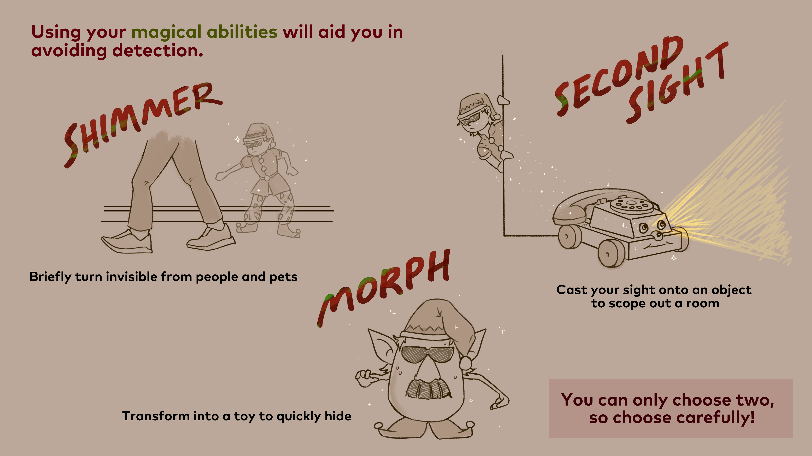

- **Second Sight** — see through nearby toys. **Morph** — become a toy to hide. **Shimmer** — brief invisibility.

#### Tips
- Cheer smoke acts as a hiding spot while gathering clues.
- Dialogue opportunities are marked with star icons above human and pet heads.
- Second Sight objects are indicated by blue diamonds.
- Detection states are visualised by the radius at characters' feet.

</details>

## 🙌 Credits

**Web remake** — Echo (Beili) Yin

**ABK Jam Team 7 (original)**

| Name | Role |
| --- | --- |
| Shawn Wells | Producer / Level Designer |
| Mondae Atughonu | Gameplay and AI Programming |
| Echo (Beili) Yin | Generalist Programmer |
| Jonathan Librizzi | UI Engineer |
| Milton Clark | Software Engineer |
| Sara Zorns | Concept Artist, 2D Artist, and Narrative Designer |
| Molly Carroll | Environment Artist and 3D Modeler |
| Lu Xu | Opening Cinematic Artist |
| Andre B | Concept Artist |

**Assets** — 3D models, particles, sound effects and jingles by [Kenney](https://kenney.nl) (CC0) ·
public-domain carol melodies · fonts under the SIL Open Font License.

## 📜 License

Code is licensed under the MIT License — see [LICENSE](LICENSE). Kenney assets are CC0; licence files ship in
[`public/assets/licenses`](public/assets/licenses).

<p align="center"><sub>Made with 🎄, ❄️ and a suspicious amount of gingerbread.</sub></p>
