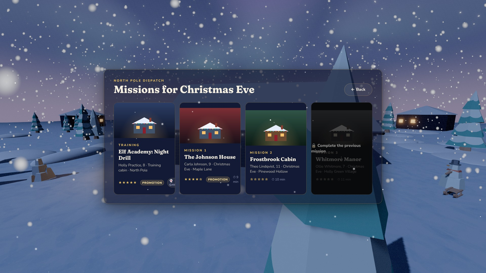
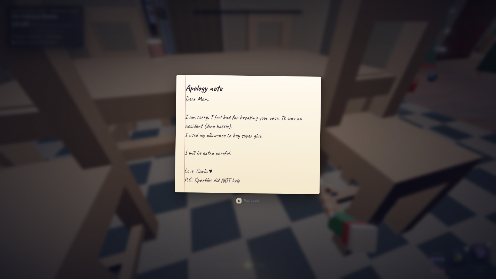
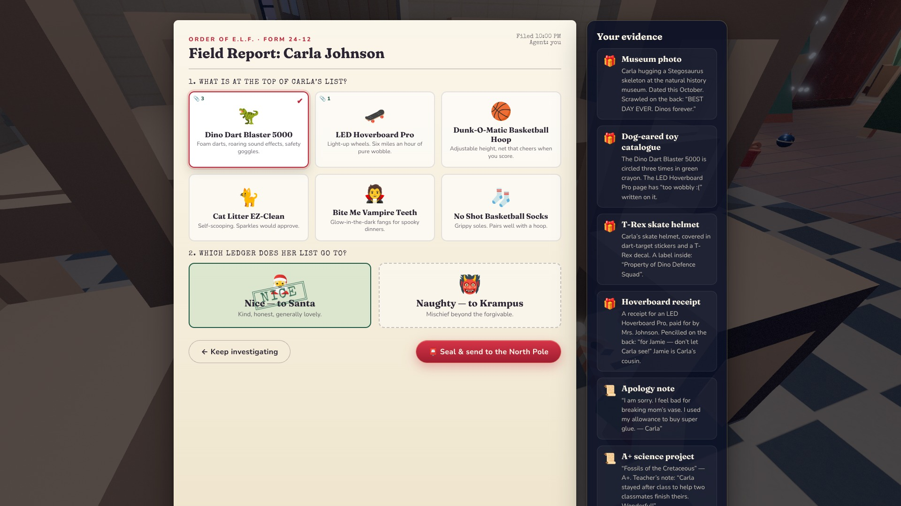

# The Order of E.L.F. — Press & Media Kit

> **Elves Lurking Festively.** A cosy first-person stealth immersive sim for the browser.
> Sneak through family homes on Christmas Eve, uncover what each child *really* wants,
> and decide whether their list goes to **Santa** or **Krampus**.

**▶ Play free:** https://echoness.itch.io/the-order-of-elf-remake
**Source:** https://github.com/e-choness/the-order-of-elf

---

## Fact sheet

| | |
| --- | --- |
| **Title** | The Order of E.L.F. (Web Remake) |
| **Developer** | Echo (Beili) Yin, building on the ABK Game Jam Team 7 original |
| **Genre** | First-person stealth · immersive sim · cosy detective |
| **Platform** | Web browser (desktop, keyboard & mouse) — WebGL 2 |
| **Price** | Free |
| **Release** | October 2026 (web remake) · original Unity game-jam version by ABK Jam Team 7 |
| **Session length** | 10–15 minutes per mission · 4 missions (incl. tutorial) |
| **Engine / tech** | Three.js, TypeScript, Vite, pmndrs postprocessing, N8AO, Web Audio |
| **Art** | Kenney CC0 low-poly kits + procedural textures |
| **Languages** | English |
| **Licence** | Code MIT · assets CC0 · fonts OFL |
| **Store page** | https://echoness.itch.io/the-order-of-elf-remake |

## Short description (≈ 50 words)

Every Christmas Eve, wish lists get smudged. As an agent of the Order of E.L.F. you slide
down the chimney, sneak past parents, pets and one very suspicious robot vacuum, and
gather evidence of what the child truly wants — and whether they've been naughty or nice.

## Long description

The Order of E.L.F. began as a Unity game made in a week by ABK Jam Team 7. This remake
rebuilds it for the browser as a small but complete **immersive sim**: every house is a
sandbox of systems that you can play however you like.

Light is real — the fire, the fairy lights, a grandfather's torch and the moonbeams
through the windows decide how visible you are. Sound is real — polished floorboards
creak, tiles clatter, carpets muffle, and a glass bauble shattered in the kitchen will
pull the whole family away from the living room. People follow their own Christmas Eve
routines, chat about the children when they think no one is listening, notice the lamp
you switched off and the ornament you broke, and search when they're sure they saw
*something small and pointy-eared*.

Your toolkit is pure elf magic: **Shimmer** into invisibility, **Morph** into a
nutcracker, borrow a snow globe's eyes with **Second Sight**, toss a **Jingle Lure**, or
send someone off to dreamland with a puff of **Christmas Cheer**. Hide in wardrobes,
under beds, behind curtains, among the presents — or inside a cardboard box. Bribe the
dog. Gossip with the cat. Eat Santa's cookies (he'll never know).

When you've gathered enough evidence, climb back up the chimney and file your report.
Pick the right gift and the right ledger to earn your promotion.

## Features

- 🏠 **Four hand-built missions** — Elf Academy (tutorial), The Johnson House, Frostbrook Cabin, Whitmore Manor
- 🔦 **Light-and-shadow stealth** with a live light gem, vision cones and torch beams
- 👂 **Sound propagation** — surface footsteps, squeaky boards, thrown objects, muffling walls and doors
- 🧠 **Systemic AI** — routines, suspicion, investigation, chases, searches, conversations and sleep
- 🐾 **Pets with personality** — a cat who gossips, a dog who smells through magic, a robot vacuum with antlers
- ✨ **Five elf powers** plus hiding spots, throwables, climbing and cookies
- 🕵️ **Deduction** — wishes, deeds and rumours, with decoys that only careful reading exposes
- 🎶 **Live-synthesised carols** that swell when you're spotted; HRTF 3D sound
- 🎨 **Modern rendering** — ambient occlusion, bloom, AgX tone mapping, moonlit shadows, aurora skies
- ♿ **Accessible** — subtitles (3 sizes), reduce-motion, FOV & sensitivity, vision-cone toggle

## Screenshots

| | |
| --- | --- |
|  |  |
|  |  |
|  |  |
|  |  |
|  |  |
|  |  |

All screenshots are 1920×1080 JPEG (q92), captured in-engine.

## Animated

| Snowy house | Sneaking |
| --- | --- |
|  |  |

## Logos, icons & art

| File | Size | Use |
| --- | --- | --- |
| [`logo/logo-transparent.png`](logo/logo-transparent.png) | 394×224 | Logo on dark or photo backgrounds |
| [`logo/logo-on-night.png`](logo/logo-on-night.png) | — | Logo on solid night blue |
| [`logo/icon-512.png`](logo/icon-512.png) · 256 · 128 · 64 | square | App / favicon / avatar |
| [`art/itch-cover-630x500.png`](art/itch-cover-630x500.png) | 630×500 | itch.io cover |
| [`art/banner-1920x480.png`](art/banner-1920x480.png) | 1920×480 | Page header / store banner |
| [`art/github-social-1280x640.png`](art/github-social-1280x640.png) | 1280×640 | GitHub social preview, Open Graph |
| [`art/capsule-460x215.png`](art/capsule-460x215.png) | 460×215 | Small capsule / listing tile |
| [`art/wallpaper-1920x1080.jpg`](art/wallpaper-1920x1080.jpg) | 1920×1080 | Key art with logo |
| [`art/wallpaper-fireplace-1920x1080.jpg`](art/wallpaper-fireplace-1920x1080.jpg) | 1920×1080 | Cosy alternative key art |
| [`art/keyart-clean.jpg`](art/keyart-clean.jpg) · [`art/fireplace-clean.jpg`](art/fireplace-clean.jpg) | 1920×1080 | Text-free art for your own layouts |

**Palette** — Night `#0B1022` · Gold `#E8C062` · Cranberry `#C0283B` · Pine `#1F5A45` · Frost `#BFE3FF` · Paper `#FBF3DF`
**Type** — Fraunces (display) · Nunito (UI) · Caveat (handwriting) · Special Elite (dossiers) · Mountains of Christmas (tagline)

## Credits

**Web remake** — Echo (Beili) Yin

**Original game — ABK Jam Team 7**: Shawn Wells (producer / level design), Mondae Atughonu
(gameplay & AI), Echo (Beili) Yin (generalist programmer), Jonathan Librizzi (UI), Milton Clark
(software engineer), Sara Zorns (concept, 2D art & narrative), Molly Carroll (environment art),
Lu Xu (opening cinematic), Andre B (concept art).

**Assets** — 3D models, particles, sound effects and jingles by [Kenney](https://kenney.nl) (CC0).
Carol melodies are public domain. Fonts under the SIL Open Font License.

## Usage

You're welcome to use anything in this folder to write about, stream or share the game.
No need to ask — a link to the itch.io page is always appreciated.

### Regenerating the kit

The tools in [`tools/`](tools/) re-render everything from the live game: run `npm run dev` in `web/`, then
`node tools/capture-screenshots.mjs`, `node tools/capture-gif-frames.mjs <orbit|sneak>` (encode with ffmpeg) and
`python3 tools/compose-art.py` for the covers, banners and icons.
